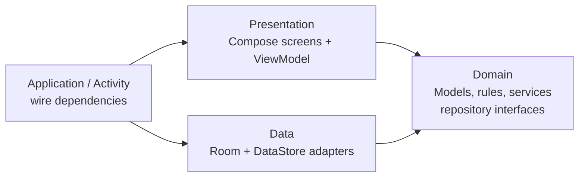

# GymTracker codebase demonstration

Start with one Bench Press set: **185 lb × 8**. Follow it from editable text to saved history and progress.

The [interactive demonstration](codebase-demo.html) is a single HTML file that runs offline.
From your checkout, open `docs/codebase-demo.html` in a browser. On GitHub, use **Raw → Save As** and open the downloaded file.
GitHub displays HTML as source. This Markdown guide renders directly on GitHub.

The browser shows illustrative state snapshots; it has no connection to the Android database.
The runnable Kotlin example below calls the real domain code. Source excerpts in the browser are pinned to commit `44572a6`.

## The three layers



| Layer | What it owns | Example |
| --- | --- | --- |
| Presentation | What is on screen, user actions, in-memory drafts and UI state | `WorkoutScreen`, `TrackerViewModel` |
| Domain | Valid sets, pound conversion, saving model construction, strength math, repository contracts | `DraftSet`, `WorkoutService`, `ProgressCalculator` |
| Data | Database entities, queries, transactions and persisted preferences | `RoomTrackerRepository`, `TrackerDatabase`, `DataStoreSettingsRepository` |

Data implements the repository interfaces declared by domain. The ViewModel receives those interfaces by constructor.
The domain service builds a Workout; the ViewModel then passes that Workout to the repository.

## First launch: where to start reading

1. [GymTrackerApplication](../app/src/main/java/com/gymtracker/android/GymTrackerApplication.kt#L13) lazily constructs Room and the two repository adapters.
2. [MainActivity](../app/src/main/java/com/gymtracker/android/MainActivity.kt#L15) calls `setContent` and supplies a ViewModel factory with those repositories.
3. [TrackerViewModel](../app/src/main/java/com/gymtracker/android/presentation/TrackerViewModel.kt#L25) seeds missing presets, then collects a combination of workout data and settings Flows.
4. [GymTrackerApp](../app/src/main/java/com/gymtracker/android/presentation/composables/GymTrackerApp.kt#L23) collects observable UI state with lifecycle awareness and selects a screen.
5. [WorkoutScreen](../app/src/main/java/com/gymtracker/android/presentation/composables/screens/WorkoutScreen.kt#L19) renders the draft and passes callbacks to the reusable [SetRow](../app/src/main/java/com/gymtracker/android/presentation/composables/components/CommonComponents.kt#L46).

Open these files in that order to understand startup before studying any individual feature.

## Trace one saved workout

```mermaid
sequenceDiagram
    participant C as Compose / SetRow
    participant V as TrackerViewModel
    participant D as Domain models + WorkoutService
    participant R as RoomTrackerRepository
    participant Q as Room DAO / SQLite
    C->>V: editSet(exerciseId, setId, "185", "8")
    V->>V: copy row into WorkoutSession
    V-->>C: new TrackerUiState through StateFlow
    C->>V: finish()
    V->>D: inspect validSetCount / invalidSetCount
    opt There is an incomplete extra row
        V-->>C: confirmFinish = true
        C->>V: Discard & Save → save()
    end
    V->>D: WorkoutService.build(session)
    D-->>V: valid Workout (weightLb = 185)
    V->>R: saveWorkout(workout)
    R->>Q: transaction: upsert workout, clear old sets, insert new sets
    Q-->>R: transaction completes
    R-->>V: save call returns
    V->>V: reset draft; set completed
    Q-->>R: observable query results refresh
    R-->>V: TrackerData through Flow
    V-->>C: refreshed UI data / completion state
    Note over Q,C: Query refresh and completion updates are asynchronous.
```

| Stop | File / method | What to inspect |
| --- | --- | --- |
| Typing | [SetRow](../app/src/main/java/com/gymtracker/android/presentation/composables/components/CommonComponents.kt#L46) → `WorkoutActions.editSet` | Weight and reps remain text while you type. |
| Draft state | [TrackerViewModel](../app/src/main/java/com/gymtracker/android/presentation/TrackerViewModel.kt#L25) / `editSet()` | `state.value.session`; copies make the update observable. |
| Validation | [Models.kt](../app/src/main/java/com/gymtracker/android/domain/model/Models.kt#L55) / `DraftSet.isValid` | Positive finite canonical weight and positive integer reps. |
| Finish | [TrackerViewModel](../app/src/main/java/com/gymtracker/android/presentation/TrackerViewModel.kt#L25) / `finish()` | No valid sets prevents saving; partial rows can require confirmation. |
| Build model | [WorkoutService](../app/src/main/java/com/gymtracker/android/domain/service/WorkoutService.kt#L8) / `build()` | Invalid rows filtered; pounds stored; set numbers/order assigned; names trimmed. |
| Persist | [RoomTrackerRepository](../app/src/main/java/com/gymtracker/android/data/repository/RoomTrackerRepository.kt#L31) / `saveWorkout()` | One transaction replaces the full set list atomically. |
| Observe | [TrackerDatabase / TrackerDao](../app/src/main/java/com/gymtracker/android/data/local/TrackerDatabase.kt#L38) query Flows → repository → ViewModel collector | Database changes become domain models and refreshed UI data. |
| Progress | `WorkoutSet` + `ProgressCalculator` | Volume and estimated 1RM are derived from saved sets. |

For 185 lb × 8:

```text
Editable draft: weightText="185", repsText="8", entryUnit=LB
Saved model:   weightLb=185.0, reps=8, setNumber=1, sortOrder=0
Volume:        185 × 8 = 1,480 lb
Estimated 1RM: 185 × (1 + 8 / 30) = 234.33 lb
```

Typing and adding rows update the in-memory draft. Finishing commits to Room.
ViewModel state survives configuration changes. Finished workouts survive app restarts; unfinished drafts do not survive process termination.

## Run the real Kotlin example

From the repository root, with JDK 17 and Android SDK 35 installed:

```sh
./gradlew testDebugUnitTest --tests 'com.gymtracker.android.demo.CodebaseDemoTest' --info --rerun-tasks
```

On Windows, use `gradlew.bat` in place of `./gradlew`.
No emulator is needed. First Gradle sync/build needs internet for dependencies.

[CodebaseDemoTest](../app/src/test/java/com/gymtracker/android/demo/CodebaseDemoTest.kt) prints a story and verifies:

1. A valid row and an incomplete row become a session with one of each.
2. Choosing Discard & Save builds a workout containing only the valid row.
3. Pound storage and set numbering/order stay correct.
4. Display conversion to kg preserves 185 canonical pounds.
5. Editing preserves workout/set IDs while changing weight.
6. A second workout at 195 lb × 8 produces +10 lb and a 247 lb estimated 1RM.
7. CSV exports pounds.
8. An all-invalid session is rejected.

Output checkpoints are labeled `[1]` through `[9]` under the Gradle test output.
They are also captured in `app/build/test-results/testDebugUnitTest/`.
This example exercises domain code. The next commands exercise actual persistence and Compose.

### Actual Room storage on a device/emulator

```sh
./gradlew connectedDebugAndroidTest -Pandroid.testInstrumentationRunnerArguments.class=com.gymtracker.android.data.RoomRepositoryTest
```

[RoomRepositoryTest](../app/src/androidTest/java/com/gymtracker/android/data/RoomRepositoryTest.kt) seeds the library,
saves a workout, closes/reopens the database, edits/deletes a workout, and verifies delete-all/reseed behavior.

### Actual Compose workout entry on a device/emulator

```sh
./gradlew connectedDebugAndroidTest -Pandroid.testInstrumentationRunnerArguments.class=com.gymtracker.android.presentation.WorkoutFlowTest
```

[WorkoutFlowTest](../app/src/androidTest/java/com/gymtracker/android/presentation/WorkoutFlowTest.kt) taps Start Workout,
enters Bench Press 185 × 8, saves, opens History and checks the recorded set.

## Try three variations in the browser

- **Change units:** choose 100 kg × 8. The saved model holds 220.462 lb. Volume is 1,763.696 lb and estimated 1RM is about 279.25 lb. Selecting another entry unit converts text while preserving pounds.
- **Add an incomplete row:** step to Finish. Discard & Save removes the incomplete row from the saved model; Keep Editing returns to the draft.
- **Simulate a save error:** step to Room. No rows are committed; the ViewModel exposes an error and keeps the draft. Retry demonstrates a successful transaction.

Reps must be a positive whole number. For example, empty text, zero or `8.5` blocks saving.
The browser reproduces common examples in JavaScript. Kotlin's parsing and Room behavior are verified by the runnable examples.

## Compose previews

All composables live under `presentation/composables/`.
Open a file such as `screens/WorkoutScreen.kt` or `components/ExerciseCard.kt`, then select Android Studio's **Split** or **Design** view and refresh the `@Preview`.

The previews use `previews/PreviewData.kt` and stateless callbacks. They construct sample state without a database or ViewModel.
Use **Interactive Preview** for local visual interactions. The emulator runs the complete app, including real ViewModel actions and persistence.

## Where to make a change

| Goal | Start here | Follow through |
| --- | --- | --- |
| Change layout or styling | `presentation/composables/screens/`, `components/`, `theme/` | Check relevant previews. |
| Add a preset exercise or split | `data/seed/DefaultLibrary.kt` | Keep IDs stable; seed only missing records. |
| Change validation or units | `domain/model/Models.kt` | Check domain tests and the demo's unit conversion. |
| Change how drafts save | `domain/service/WorkoutService.kt` | ViewModel orchestration, then repository transaction. |
| Change progress math | `WorkoutSet` properties and `domain/service/ProgressCalculator.kt` | Home and Progress rendering. |
| Add a preference | `domain/model/Settings` and `data/repository/DataStoreSettingsRepository.kt` | SettingsScreen and ViewModel state. |
| Change stored fields | `data/local/TrackerDatabase.kt` | Add a migration and commit the generated Room schema. |
| Add a tab | `presentation/Tab` and `composables/GymTrackerApp.kt` | New stateless screen, callbacks and preview. |

`reference/ios/` is the preserved original Swift app. The Android build compiles `app/src/`.

## Debugging a problem

- **Typing does not update:** inspect `SetRow` callbacks, `WorkoutActions`, `editSet()`, and the new `TrackerUiState`.
- **Finish is unavailable:** inspect `validSetCount`, `DraftSet.weightLb`, `reps`, and `isValid`.
- **Save fails:** break in repository `saveWorkout()` and ViewModel `action()`; inspect the error while the draft is retained.
- **History does not refresh:** inspect DAO Flows, repository mapping, the collector and lifecycle collection in `GymTrackerApp`.
- **Wrong units or progress:** inspect canonical pounds, the row's `entryUnit`, and the calculator's per-workout history.

## The build path

`.github/workflows/android-ci.yml` runs architecture checks, compilation, unit tests, lint and APK packaging.
It then boots an Android emulator and runs the storage and Compose tests.
Dependabot proposes dependency updates against develop; CI checks compatibility.
The release workflow packages unsigned APKs on version tags; Android signing remains a separate distribution step.
